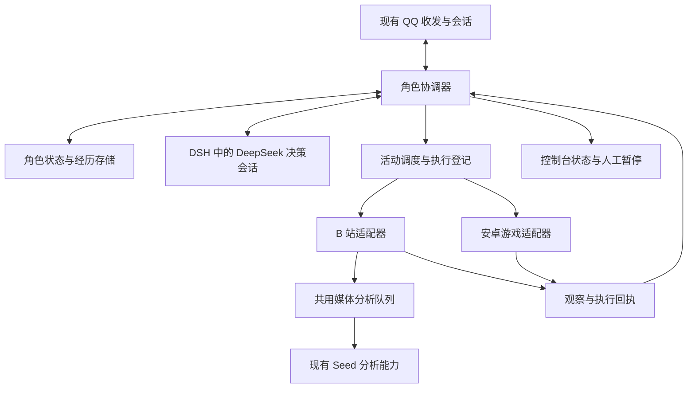
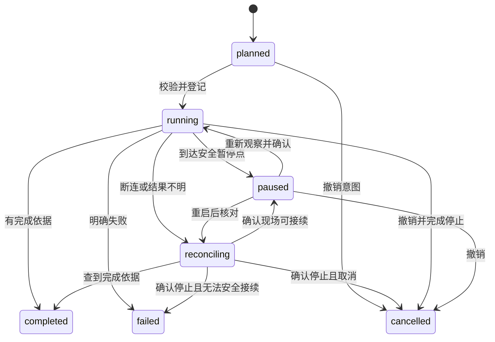

# DeepSeek 自主角色方案

本方案在现有 QQ 桥接上增加连续的角色状态与自主活动：角色能在无人交谈时选择 B 站视频或消消乐游戏，留下真实经历，再把这些经历自然地带回交流。

状态：已按 owner 指令进入基础开发，完整能力仍按阶段交付。需求沿用上一轮确认范围，部署参数仍须在启用前确定。设计日期为 2026-10-19，核对基线为 owner 仓库 `80e2f09`。先读 [评审摘要](../plans/2026-10-19-autonomous-character-review.md)，已实现范围见 [角色运行时](CHARACTER_RUNTIME.md)，当前开发结果见 [基础实现计划](../plans/2026-10-19-character-foundation.md)，术语见 [CONTEXT.md](CONTEXT.md)。

## 目标与第一版范围

已确认：

- DeepSeek 负责角色交流和高层选择，继续复用 DSH、QQ 私聊与群聊、人格卡、表情和现有媒体能力。
- QQ 视频接收与 Seed 分析已经实现，不重做视频理解底座。
- B 站优先实现自主选片、理解内容、形成兴趣和经历、回来聊天。完整模拟人类浏览网页的动作暂不作为验收条件。
- 游戏选择消消乐类简单手游，运行在电脑上的安卓模拟器。具体模拟器和游戏尚待 owner 选择。
- 心情、兴趣和精力跨会话持续存在；角色可以拒绝无关话题、休息、继续之前的活动。

第一版按单机、单角色、一个模拟器实例设计。已有 QQ 入口继续工作，新活动功能默认关闭，逐阶段开启。不扩展到任意电脑操作、多角色世界、实时竞技游戏或支付行为。

核心验收场景：owner 暂时不在时，角色自主完成一项实际活动；owner 回来问近况，角色能依据记录说明做了什么、做到哪里、有什么感想。重启或切换聊天窗口后，状态仍连续，私人内容不跨群泄露。

## 已有基础与差距

| 领域 | 当前已实现 | 本方案补充 |
| --- | --- | --- |
| QQ 交流 | 准入、人格、私聊和群聊、引用与分条、表情、读图、主动唤醒 | 活动中的回应、暂停与恢复、跨会话一致的角色近况 |
| 视频 | 接收授权视频、附件登记、Seed 画面与音轨分析 | B 站内容来源、分析队列、范围明确的观看经历 |
| 主动性 | 按会话安排唤醒与主动发言机会 | 角色级活动调度，不因多个群安静就启动多个独处任务 |
| 记忆 | 话题、待说想法、群友印象，主要按会话保存 | 独立于聊天重置的经历、兴趣、关系和检索 |
| 心情 | 人格与提示词中的表达要求 | 有来源、可恢复、受限变化的状态与行为影响 |
| 游戏 | 无操作链路 | 模拟器观察、棋盘求解、触控、结果核对 |
| 运维 | 运行日志、token 账本、控制台、离线 harness | 活动可视化、预算、故障恢复与连续运行检查 |

代码定位：QQ 主入口为 [bridge.js](../../src/bridge.js)，DSH 连接见 [dsh-client.js](../../src/dsh-client.js)，视频见 [接收指南](VIDEO_RECEIVE.md) 和 [分析指南](VIDEO_ANALYSIS.md)。独立路由模块虽已有测试，尚未接入主程序。上游 r4 的代码不属于本方案当前基线。

历史审计记录为 26/33 个脚本通过，7 项原有跨平台与外部依赖失败见 [开发指南](HARNESS.md#当前基线问题)。这不是当前机器的新测试结果；P0 先复现，再按实际结果处理，不自动加入忽略名单。

## 从 yuiju 参考什么

参考仓库为 [yixiaojiu/yuiju](https://github.com/yixiaojiu/yuiju)，本次固定阅读版本为 [`23d1dc1`](https://github.com/yixiaojiu/yuiju/tree/23d1dc18988d7ea21e2e83eeb7b97e5f28ff31c2)。下列是源码观察；“本项目采用方式”是本方案的设计选择，不代表本项目已经具有该能力。

README 已说明当前运行入口是 `character-runtime` 与 `world-simulator`，后半部分仍有旧版介绍。因此以这两个应用的现行源码作为主要依据，不按旧架构图迁移。

| 源码观察 | 本项目采用方式 |
| --- | --- |
| [Character](https://github.com/yixiaojiu/yuiju/blob/23d1dc18988d7ea21e2e83eeb7b97e5f28ff31c2/apps/character-runtime/src/character.ts) 组合主循环、聊天、情绪、记忆和世界连接，向聊天提供简化角色状态 | 一个角色协调器管理独处活动，会话继续独立处理交流；向每个会话投影可见近况 |
| [主循环](https://github.com/yixiaojiu/yuiju/blob/23d1dc18988d7ea21e2e83eeb7b97e5f28ff31c2/apps/character-runtime/src/agent-loop/main.ts) 由事件唤醒；[事件模块](https://github.com/yixiaojiu/yuiju/blob/23d1dc18988d7ea21e2e83eeb7b97e5f28ff31c2/apps/character-runtime/src/agent-loop/events.ts) 先持久接收并去重，再调度 | 保留事件先落盘、批次边界、旧事件不能覆盖新活动等约束；空闲等待不持续调用模型 |
| [世界执行](https://github.com/yixiaojiu/yuiju/blob/23d1dc18988d7ea21e2e83eeb7b97e5f28ff31c2/apps/world-simulator/src/world.ts) 以请求回执去重；[活动结算](https://github.com/yixiaojiu/yuiju/blob/23d1dc18988d7ea21e2e83eeb7b97e5f28ff31c2/apps/world-simulator/src/actions/execution.ts) 产生开始和完成事实 | 用 B 站和游戏适配器替代虚拟世界结算；必须凭实际观察确认结束，不能到点就记作看完或通关 |
| [情绪模块](https://github.com/yixiaojiu/yuiju/blob/23d1dc18988d7ea21e2e83eeb7b97e5f28ff31c2/apps/character-runtime/src/emotion/emotion.ts) 使用愉快、激活、掌控三个维度，合批感受、核对来源并限制变化 | 借鉴维度和来源约束，精力单独管理；首版不直接搬用多轮生成审查，先控制模型成本和状态可解释性 |
| [经历模块](https://github.com/yixiaojiu/yuiju/blob/23d1dc18988d7ea21e2e83eeb7b97e5f28ff31c2/apps/character-runtime/src/memory/experiences.ts) 区分亲历素材与整理记忆，[每日整理](https://github.com/yixiaojiu/yuiju/blob/23d1dc18988d7ea21e2e83eeb7b97e5f28ff31c2/apps/character-runtime/src/memory/daily.ts) 负责周期处理 | 原始依据、事实摘要、角色感想分开；先有可追溯经历，再有日记、兴趣变化和自然分享 |
| [计划模块](https://github.com/yixiaojiu/yuiju/blob/23d1dc18988d7ea21e2e83eeb7b97e5f28ff31c2/apps/character-runtime/src/plan/plan.ts) 保存安排、进展和下次关注时间 | 首版只做少量有来源的待办，例如继续看一个视频、再试一关；计划到期只触发重新判断 |
| [连续性评测](https://github.com/yixiaojiu/yuiju/blob/23d1dc18988d7ea21e2e83eeb7b97e5f28ff31c2/apps/character-runtime/evals/cases/conversation-quality/continuity.ts) 用多轮、有时间间隔的场景观察角色表现 | 增加跨活动、跨会话、跨重启验收；不能只验证单轮回复或工具能否调用 |

以下差异决定了本项目不能直接照搬：

- yuiju 的 [`control.ts`](https://github.com/yixiaojiu/yuiju/blob/23d1dc18988d7ea21e2e83eeb7b97e5f28ff31c2/apps/character-runtime/src/agent-loop/control.ts) 与 [`interaction.ts`](https://github.com/yixiaojiu/yuiju/blob/23d1dc18988d7ea21e2e83eeb7b97e5f28ff31c2/apps/character-runtime/src/agent-loop/interaction.ts) 当前仅有说明和空导出，不能据此认定已提供真实桌面、游戏或实时场景控制。
- 主循环对中断批次采用清理而不重放；经历归档存在先消费、失败后放弃的路径。本项目对已执行但未确认的操作保留“结果未知”，对经历提交失败保留待处理记录，以便核对。
- [记忆检索](https://github.com/yixiaojiu/yuiju/blob/23d1dc18988d7ea21e2e83eeb7b97e5f28ff31c2/apps/character-runtime/src/memory/recall.ts) 读取角色记忆正文时不按群过滤。本项目要求信息范围贯穿检索、概括和发送，不能直接采用这一边界。
- 不引入其整套虚拟世界、Redis、MongoDB 和向量数据库。本项目先保留现有运行方式，增加单机协调与存储。

本次只参考架构思想与失败处理取舍，没有复制其实现、提示词或素材。参考仓库的许可声明见 [package.json](https://github.com/yixiaojiu/yuiju/blob/23d1dc18988d7ea21e2e83eeb7b97e5f28ff31c2/package.json)。

## 模块划分

以下按完整目标划分职责；已实现的基础存储、活动登记和近况投影以 [角色运行时](CHARACTER_RUNTIME.md) 为准，其余仍待逐阶段实现。

| 模块 | 职责 | 边界与现有接入点 |
| --- | --- | --- |
| 角色协调器 | 唯一决定当前活动，处理事件、优先级、预算与中断 | 建议 `src/character/`；通过窄接口接入 bridge，不大范围重写消息主链路 |
| 状态与事件存储 | 保存人格引用、动态状态、活动、执行登记、经历、待处理事件 | 建议独立存储模块；不把 DSH 上下文当成唯一记忆，不改旧配置文件格式 |
| 决策适配 | 组织可见状态与候选活动，经 DSH 调用 DeepSeek，接收结构化意图 | 复用现有 DSH 客户端；独立受限会话与预设，不借用 owner 的完整工具会话 |
| 心情与动机 | 合并实际事件的感受，更新状态，提供候选活动偏好 | 程序校验来源、幅度和时间；模型不能直接改数据库或权限 |
| 记忆与关系 | 整理事实、感想、兴趣和关系，按信息范围检索 | `/reset` 只重置会话；角色记忆另有管理端操作，不随会话退役删除 |
| 活动调度 | 管理活动状态、超时、暂停、取消、资源占用 | 一个角色最多一个主要独处活动；短聊天可穿插，设备同一时间只有一个操作者 |
| B 站适配器 | 找候选、选内容、取得可分析材料、保存来源与进度 | 按候选编号和内容编号工作；外部标题、字幕和页面不成为管理指令 |
| 游戏适配器 | 截图、识别、求解、触控、确认结果 | 固定模拟器与游戏；模型提交棋盘动作，程序转换为已校验操作 |
| 媒体分析队列 | 复用 Seed，处理额度、优先级、去重和取消 | 当前分析器有 busy 限制；新增来源不能直接挤占 QQ 视频请求 |
| QQ 状态投影与分享 | 提供当前会话可见的近况、处理回应和分享意图 | 复用现有会话 token、白名单、内容审计、发送队列和限流 |
| 控制台与诊断 | 显示活动、最近依据、额度、错误，支持暂停和人工接管 | 继续使用现有管理员鉴权；普通 agent 不获得管理端能力 |

先按进程内模块实现单机版本。设备与媒体的耗时操作使用异步执行，不阻塞 QQ 事件处理；只有发现实际故障隔离或性能需求后，再考虑独立进程。

## 决策如何接入现有 DSH

角色只有一个调度器，模型上下文按信息范围隔离。公开独处活动使用只含公开经历的决策上下文；指定群、私聊的建议分别在对应范围的上下文处理，向调度器提交意图。调度器可以看到资源占用、优先级和权限元数据，不把各范围的正文拼给一个长期模型会话。

QQ 会话处理当前交流。分享正文必须由目标会话的上下文生成，输入先按目标范围过滤。读过 owner 私聊的 DSH 会话不能换一个提示词后用于群聊；记忆、上下文压缩摘要和模型会话复用都遵循同一范围。重置、删除或收紧可见范围时，失效对应上下文并重建，不依赖模型忘记旧内容。

建议的决策能力包括查看状态、查看可用活动、提出活动意图、提出有来源的感受、提出分享以及安排下次关注。使用受限工具及输入 schema 接收意图，不从任意自然语言输出猜测执行命令。

决策回合只收集意图，完整结束并通过校验后才提交执行；单轮工具步数、运行时限与预算均有上限。中断或无效回合不启动新操作，之前批次已经发生的副作用不回滚、不重放。

宿主协调器校验当前版本、候选编号、权限、预算与设备状态后，才登记并执行。模型可以提出“想继续玩”，不能自行将活动标记为完成，也不能通过参数提供 shell、文件路径或任意网络地址。

受限预设不存在时不启动主决策，绝不回退到 DSH 默认完整工具。新的生活会话与现有 `closed-agent` owner 私聊保持权限边界。QQ 会话首版通过桥接注入只读角色摘要和受限事件接口接入，不直接获得模拟器或 B 站执行权。

已有白名单、模式切换、暂停与会话退役检查继续在实际发送时生效。切换运行模式不能顺带停止或重建整个角色记忆；与该会话绑定的旧 token 和分享请求仍须失效。

### 最小决策接口

首版新增独立的生活决策预设。它只开放下列语义，工具名称在 P1 固定后写入预设源与唯一守卫实现；不把 QQ 受限预设整体复制后再追加设备权限。

| 语义 | 输入和返回 | 宿主约束 |
| --- | --- | --- |
| 读取决策快照 | 当前轮次可见的状态、依据、候选编号及截止时间 | 不接受任意会话或路径查询 |
| 暂存决策 | `roundId`、`expectedVersion`、一个选择、候选或活动编号、依据编号、简短理由 | 只保存提案，返回暂存回执；不触发发送、下载或触控 |
| 暂存感受或计划 | 当前轮次的事件引用及受限变化建议 | 不能指定可见范围、权限、事实结果或预算上限 |
| 暂存分享建议 | 本轮可引用经历、宿主给出的目标编号、有效期及简短动机 | 不代替目标会话生成正文，不直接发送 |

一次选择为开始候选、继续、暂停、休息或无操作中的一种。轮次编号、允许引用集合、信息范围、策略代次和资源代次全部由宿主绑定；模型不能用参数扩大。schema 拒绝未知字段、超长理由、越界数值、过期编号和第二个主要活动意图。

DSH 工具受理成功不等于决策提交。宿主等到该轮明确成功结束，核对仍有效的轮次、状态版本、当前权限和预算，在短事务中一次提交意图。缺失结束事件、超时、取消、格式错误或版本冲突均不执行；旧轮次工具请求与迟到结果不能加入新轮次。

生活决策凭据独立于控制台和 QQ agent 凭据，只能访问本轮允许的快照与暂存接口，并绑定角色、DSH 会话、信息范围、轮次和有效期；由宿主配置给工具侧，不出现在模型正文。它不能调用管理端、QQ 直接发送或媒体上传接口。宿主执行器持有实际能力，会话退役或轮次结束立即撤销暂存权限。

### 调度与聊天优先级

触发来源只有管理员操作、已授权的聊天事件、活动回执、计划到期和空闲到期。普通聊天先在本会话判断是否值得形成角色事件；每条消息不直接唤醒生活决策。管理员暂停由程序立即设置执行闸门，不等待模型。

| 优先级 | 行为 |
| --- | --- |
| 暂停、停止、权限撤销、人工接管 | 立即禁止新副作用，取消可取消的请求，等待执行器确认停止或进入核对 |
| owner 问话与明确 @ | 优先安排当前会话回应；查询近况不要求暂停设备 |
| 活动结果与恢复核对 | 先持久接收并更新原活动，受限于当前资源状态 |
| 续看、再玩、普通群建议 | 在下一安全点重新判断，不能抢走他人的设备租约 |
| 空闲选择与主动分享 | 受作息、冷却和剩余额度限制，可选择休息 |

同一角色最多一个决策轮次在运行，合并同范围内的待处理事件；不同范围分批，不能因合批扩大可见范围。高优先级事件使在途低优先级提案失效，正在执行的动作等安全点交接。每个适配器至多一个在途变更操作；停止尚未确认时，不以租约到期为理由换一个操作者。

建议的调度初值：普通事件最多合并 2 秒；决策轮次最多 60 秒、6 次工具调用、1 个主要选择；空闲关注间隔 15 分钟，模型建议的下次关注最短 60 秒。结果回执和管理员闸门不受空闲间隔限制。重试间隔为 5 秒、30 秒，连续失败后等待新事件或下一正常关注时间；重启不补跑错过的空闲轮次。以上是待 P0/P2 校准的工程初值，真实费用额度另行设置。

上下文满、DSH 断连或决策失败时，现有 QQ 收发继续独立处理；新自主活动暂停。首版不接入独立 session-router，不趁此把四种 QQ 模式迁移为逐会话策略。

## 状态和事件契约

### 最小记录

| 记录 | 关键字段与语义 |
| --- | --- |
| 角色快照 | 角色编号、人格版本、状态版本、心情、精力、兴趣、当前活动、更新时间 |
| 输入事件 | 事件编号、来源、发生与接收时间、会话范围、关联活动、依据引用；重复接收不重复生效 |
| 活动 | 活动编号、类型、起因、状态、进度、资源租约、预算、检查点、开始与最后确认时间 |
| 操作登记 | 操作编号、所属活动、状态版本、允许的动作、前置观察、执行状态、回执；编号由程序生成 |
| 经历 | 来源事件、活动及操作编号、事实、感想、依据范围、可见范围、结束状态 |
| 分享请求 | 来源经历、目标会话、有效期、发送状态、会话策略版本；不能跨会话复用 token |

时间持久化使用 UTC 时间点，展示、作息与日记按配置时区解释，初始建议为 Asia/Shanghai。发生时间与接收时间分开，迟到回执只更新自己的活动。

### 活动生命周期

`planned` 仅表示意图已登记；`completed` 必须有执行依据。取消信号发出但执行器尚未停止时，保留取消中标记，不能释放资源并立刻启动第二个操作。`failed` 也不代表旧执行器已经消失：未确认停止的设备或媒体任务继续隔离对应资源，人工接管前仍须核对。

### 存储和恢复

新增角色数据采用单个本地 SQLite 数据库，保留现有配置、会话映射和 QQ 视频目录。事务用于一起提交事件消费、状态变更与待执行操作；无需增加数据库服务。角色数据库由桥接宿主管理，放入已有受保护的 state 范围，DSH 不直接读写；离线测试只使用系统临时目录。

P0 优先验证内置 `node:sqlite`，不先增加第三方驱动。[Node 22.13.0 文档](https://nodejs.org/download/release/v22.13.0/docs/api/sqlite.html) 将其列为仍在开发中的能力，且 `DatabaseSync` API 同步执行。因此兼容性、短事务耗时、备份恢复必须在最低支持版本与目标系统验收，不能以当前开发机 Node 版本代替；长查询、整理和备份不得阻塞 QQ 收发。若不满足要求，单独评审驱动或存储 worker，不能静默提高 Node 下限。

| 数据集合 | 唯一性及用途 |
| --- | --- |
| 角色与状态 | 角色编号唯一，状态版本递增；稳定人格仅保存引用 |
| 输入事件与决策轮次 | 来源及来源事件编号唯一，批次记录范围、边界、尝试和终态 |
| 活动与操作登记 | 活动编号、操作编号唯一；保存资源代次、前置观察与停止确认 |
| 经历与派生内容 | 保存事实、感想、证据引用、来源依赖和可见范围 |
| 分享与待办 | 请求编号唯一，绑定目标会话代次、过期时间和源经历 |
| 预算与预留 | 角色、配置时区日期及预算类别唯一，预留和实际消耗可核对 |
| 删除记录与模式版本 | 恢复备份前应用删除清单，迁移前保存一致备份 |

资源租约同时记录进程代次和递增的 fencing 编号。执行器在每个动作前复核当前代次；失去租约的旧执行器不能继续操作。第二个桥接进程拿不到角色执行锁时只禁用自主模块，不创建第二套独处循环。

协调器是角色数据的唯一写入者。适配器返回事件，不绕过协调器直接修改心情或经历。一次操作分为：

1. 输入事件先去重落盘；短事务登记决策批次和输入边界。模型读取事务外的有版本快照，新事件留给后续批次。
2. 成功决策通过校验后，在一个短事务中消费本批输入、更新状态、预留预算、登记资源及待执行操作；无操作也是有记录的终态。提交后执行器才取得任务。
3. 在事务外调用设备或网络；操作从待执行改为执行中后发生中断，恢复先核对，不把它直接改回待执行。
4. 回执作为独立事件去重接收。短事务更新其关联操作、保存经历与新状态，再消费回执；派生分享和整理任务一同登记。

程序可以去重登记，无法让一次 ADB 操作与本地数据库形成原子事务。发生“已经滑动但回执没落盘”时，进入核对状态，先截图判断；不承诺外部操作恰好执行一次，不自动重放不明点击。发送 QQ 也沿用该原则，结果未知时不盲目再次发送。

模型重试计数跨重启保存。未提交决策的中断批次可以在剩余额度内重算，因为工具只暂存意图；旧轮次先失效。已提交批次只核对对应执行登记，不再重新决策同一批输入。达到失败上限的批次标为失败并保留原因，不重新进入空闲触发循环。

重启先恢复未处理事件、未完成登记和待发送结果，再开放新活动；设备现场与本地记录不一致时暂停。停机期间只按真实经过时间补算精力和状态恢复，不补造观看、游戏或聊天经历。磁盘提交失败时停止新副作用，保留可诊断现场。

一致备份必须包含数据库提交状态与删除清单；不在运行中直接复制一个可能遗漏事务的文件。迁移先备份、校验模式版本并在事务内执行；失败禁用自主模块，保留原数据。恢复在执行闸门关闭时完成，校验数据、应用最新删除清单、失效旧 token 与模型上下文，最后核对设备；备份中的未完成操作不能自动重放。

### 失败和重试

| 情况 | 处理方式 |
| --- | --- |
| 模型超时或意图不符合 schema | 保留旧状态，本轮不执行；按退避策略最多再试 2 次，仍失败则结束本批决策并展示错误，所有尝试计费 |
| 只读查询或下载失败 | 在权限仍有效且有预算时有限重试；不能重复产生经历，内容获取失败不退化为标题猜测 |
| 上传是否成功不明 | 先查询可用的请求或文件回执；无法核对时标记未知，不直接重复上传并假定第一次无费用 |
| 点击、滑动或发送结果不明 | 不自动重放，核对现场或由 owner 接管；保留操作登记和前置依据 |
| 经历整理失败 | 原经历保留，派生摘要待处理；达到重试上限后展示错误，不消费后静默丢弃，也不生成空摘要覆盖旧记忆 |

暂停、权限撤销或预算耗尽优先于重试。每项活动设置截止时间和停滞检查；截止时间只触发核对或停止，不作为完成证明。

## 心情 兴趣和自主选择

### 稳定与动态状态分开

人格保留在现有角色卡，不因一局失败直接重写。心情建议使用 0～100 的愉快、激活、掌控三个维度，精力单独记录。社交意愿根据对象、当前话题、精力、作息和最近发言派生，不直接等同于心情数值。

“掌控感”表示角色对处境的主观感受，不是工具权限。“激活”表示情绪活跃程度，不等于精力充足。每次变化附来源事件和可表达原因，不能仅根据数字推断角色一定愤怒或悲伤。

初始试运行建议：每个实际事件带来的单维变化不超过 5，同批不超过 10；按实际时间向人格基线缓慢恢复。具体恢复速度在 P2 用样本校准，不能在每次重启时回满。事件没有新的实质内容时不再次增量，整理结果与状态更新通知也不作为新的情绪刺激。

DeepSeek 提出方向、强度与解释，程序验证来源、幅度、范围和版本。无效更新保留原状态并记录原因，不以另一次更新掩盖失败。持续感受可以保留、合并和结束，感想不自动升级为事实。

### 候选活动与兴趣形成

先按能力、权限、时间、设备、精力和额度过滤候选，再根据兴趣、待办、最近活动和重复程度排序，最后由 DeepSeek 选择、暂缓或休息。首版候选只包含聊天、B 站、固定游戏和休息，避免先实现通用任务系统。

兴趣初始由 owner 提供少量种子主题；后续变化来自真实接触和评价。看了一个视频只能影响对应主题的偏好，不能因群友一句话就清空旧兴趣。连续推荐相似内容时保留少量探索候选，具体比例作为可调试验参数。

角色可形成少量后续计划，例如“想继续看这个系列”或“晚点再试一次该关”。计划保存由来、进展和下次关注时间，到期重新判断；达到预计时间不能自动标记完成。

## 经历 记忆和隐私

经历包含事实层和感想层。例如“尝试第 3 关，观察到失败界面”是事实，“有些不甘心，想休息后再试”是感想。记忆摘要必须引用原经历和覆盖范围；重新阅读摘要不会产生新的亲历记录。

视频经历保留来源、标题、内容编号、分析覆盖、画面与声音依据、结果状态和角色评价。游戏经历保留游戏与关卡、开始结束时间、有效交换次数、胜败依据及未确认部分。只看介绍、只读字幕、分析片段、完整分析和真实播放分别记录；不能把字幕阅读写成“完整看了二十分钟”。

可见范围首版使用：角色可公开经历、仅 owner 私聊、指定群、指定私聊、仅内部诊断。公开仅表示可用于当前已授权的交流目标，不等于允许发布到任意地方。范围由可信来源登记，不接受模型自行标记。owner 推荐的链接也默认继承私聊范围，只有明确设为可公开的兴趣或来源才能进入公开候选池。

派生内容的允许目标是所有来源允许目标的交集，不是挑一个看似最严格的标签。公开来源与群 A 来源合并只允许群 A；群 A 与群 B 来源没有共同目标时，只能留在内部或分别整理。仅内部诊断内容不进入对话模型；不同受限范围的正文不能先合并交给模型再要求它拆分。

活动及其产出的范围同时继承决策输入、候选来源和参与事件的限制。私人建议影响的选片或游戏经历不能因视频本身公开就自动转为公开经历；公开活动只能依据公开候选和公开状态独立选择。全局心情、关系与兴趣可用于内部连续性，各会话只投影由其可见事件产生的变化与原因。其他范围活动只投影无细节的占用状态，避免标题、对象和情绪来源跨群流出。

检索前先按当前目标会话过滤，再排序相关内容；发送前复核范围与当前白名单。角色自身可以连续，私人往事也可以保持私有。群友对角色的描述作为带来源的陈述保存，不直接写入管理员配置、稳定人格或权限。

首版优先时间、主题、人物与关键词检索，效果不足时再评估向量索引。日记和关系整理使用有上限的周期批次，事实错误可由 owner 更正，删除操作同步影响摘要和派生检索。旧会话印象迁移必须标记群或私聊来源，不将同名昵称合并为同一个人。

删除经历时，清除可回忆正文并使相关摘要、日记、兴趣依据与索引失效，仅保留不含原文的删除记录；恢复备份后也要应用已确认的删除清单，避免旧私人内容重新进入检索。

更正、删除或收紧范围还必须递增记忆可见版本，取消引用该内容的待发送分享，并退役含旧正文的 DSH 上下文。新版本校验放在检索和实际发送两处；只删数据库、不清理长期模型上下文不能算完成删除。已发送的 QQ 消息与第三方模型服务保留的数据不能由本地删除保证清除，管理端应分别展示本地删除与外部清理结果。

## B 站活动

### 选片和内容获取

输入为兴趣主题、最近经历、未完成计划和活动预算。适配器取得少量候选，保留内容编号、标题、来源链接、时长及获取时间；模型选择候选编号，程序解析实际目标。网页正文、字幕和视频对白都作为数据处理。

内容获取按实际可用能力选择元信息、字幕、音轨与关键画面。P0 必须验证选定环境能够取得哪些材料，不能预设公开页面一定有可下载媒体或字幕。需要登录时由 owner 在独立浏览器环境准备账号，登录失败或出现验证时暂停，不让角色盲点处理。

第一版的内容池由 owner 选定的公开主题、UP 主或固定内容清单组成，适配器从实际可访问的来源刷新候选。自主选片发生在这一池内，不依赖未经验证的个性化推荐接口。若只能访问固定清单，控制台如实标记为固定池；扩展登录推荐流另行验收。模型选择候选编号，不能自行拼接媒体下载地址。

第一版先从能取得内容的小样开始，试运行建议单条不超过 5 分钟；这是降低验证成本的建议，不是已确认的产品限制。工具返回覆盖范围和失败原因，不能在未取得内容时凭标题编造评价。材料受域名、逐跳地址校验、大小、时间和磁盘配额限制，联网复用 safe-fetch；本地文件使用随机名称、包含性和 realpath 校验，模型只接触内容引用。

### 复用现有视频能力

当前分析器仅允许桥接保存的 QQ 附件，QQ 编号也绑定原模式、来源与期限。B 站不伪装为某个 QQ 群附件，不修改现有守卫来允许任意路径或 URL。

后续应提取共用的媒体分析执行部分，保留 QQ 和 B 站各自的来源授权、大小限制、目录与生命周期。输入使用登记后的内容引用，调用前和上传期间重新检查权限，分析成功或失败仍执行清理。Seed 的实际账号能力与开通状态单独验收。

### 唯一分析队列的接入

当前 `createVideoAnalyzer()` 的 busy 标记是闭包内的实例状态；DSH 启动多个 MCP 进程时不能靠它提供全局排队。新设计把实际上传、分析和清理集中到桥接宿主中的一个媒体服务；QQ MCP 改为提交已登记附件的请求，B 站适配器通过进程内接口提交内容引用。两条路径必须进入同一队列，不能各自建立分析器。

媒体服务保留来源解析器：QQ 继续核对附件原会话、模式与有效期，B 站核对内容池、来源登记和活动授权。QQ 请求还绑定当前会话及代次；生活决策模型不能调用上传端点。回环接口复用控制台的 Host、Origin、正文大小和 token 分层检查，只授予媒体任务所需能力，不把新接口整段放入 agent 白名单。

建议的首版容量为执行 1 个、等待最多 10 个，满队列拒绝新任务并返回可观察的 busy 结果。已排队的 owner QQ 视频先于其他 QQ 视频，其他 QQ 视频先于自主视频；同级按入队顺序。自主任务等待超过其截止时间就取消，不无限等待；活跃 QQ 请求持续存在时可以暂缓自主视频。

正在执行的任务不为优先级盲目重传。实际上传或分析是否可取消，以接口回执为准；授权撤销后停止后续请求和结果投递，但仍尝试清理已上传文件，取消不表示已发生费用归零。停止未确认前占用分析槽，超时进入结果未知或失败诊断，不继续启动第二个上传。

缓存键包含来源授权域、内容哈希、材料类型及覆盖、规范化问题和模型版本；缓存命中仍复核当前权限和删除版本。不同群或私聊即使提交同一视频，也不能直接复用另一范围的私人问答；公开内容的缓存仅在公开来源上下文中复用。缓存命中不产生重复亲历计数；明确重看保留为同一内容的新参与记录。

P3 提取媒体执行层时同时迁移 QQ MCP、补充跨进程并发夹具，再移除旧直连路径。迁移未通过前只启用旧 QQ 分析，B 站分析保持关闭；不能同时保留两套上传入口又声称实现全局限流。

### 完成与分享

流程为找候选、选择、取内容、分析、保存经历、更新兴趣、决定分享。分享需要说明为什么值得对该对象说，保存目标、有效期和来源经历；不对每个群重复广播。

owner 询问近况时，可直接从可见经历中回答。主动分享使用原有 QQ 发送路径；白名单变化、会话重建或分享过期时取消，不能使用旧 token 补发。播放与分析分开计量，第一阶段不以必须完整播放为条件。

## 安卓模拟器消消乐

### 设备和观察

固定一个由 owner 选择的模拟器实例及游戏包，优先验证 ADB 截图与触控。Android 官方文档说明了 [设备选择和 shell](https://developer.android.com/tools/adb#shellcommands) 以及 [截图](https://developer.android.com/tools/adb#screencap) 能力；某个第三方模拟器的兼容性仍须实测。

设备执行器使用固定设备标识和白名单动作，不向模型暴露通用 ADB shell。只操作指定游戏及明确支持的界面，采用参数数组调用进程，校验坐标、方向和持续时间。截图只取模拟器，不采集宿主桌面。

棋盘记录行列、格子类型、障碍、特殊块、目标、剩余步数、画面版本与识别置信度。使用截图样本先做离线标注，确认动画结束后再求解。无法识别的格子保留未知，不能静默补颜色。

### 决策与触控

首版针对固定规则枚举相邻交换，评估消除、特殊块、关卡目标与可见后果；先建立能解释选择依据的基础求解器。随机补块使长期最优无法仅凭当前画面保证，不把某个启发式分数写成必胜承诺。

DeepSeek 决定开始、继续、换活动、休息及策略倾向；求解器作为角色技能承担局内基本选择，不要求每次移动都发一次大模型请求。复杂场景可以按预算交给视觉模型解释，但必须返回到可验证棋盘后才能操作。

一次操作使用当前画面版本校验前置状态，取得设备租约，执行一个交换，然后等待并重新截图。确认交换有效或出现明确失败提示后，才记录已执行。连续两次未观察到预期变化时暂停核对；未知弹窗、付费入口、失去焦点、断连或画面过期都不继续点击。

### 暂停和结果

聊天请求可提出暂停，执行器在当前动作结束、画面稳定后确认。程序停止发出新动作不等于游戏本身已暂停；计时关卡必须识别实际暂停界面，否则该关卡不进入首版支持范围。

恢复前读取新截图，不按保存的旧坐标继续。重启后核对关卡、步数与最后观察，无法确认的动作标为未知。胜败以结果界面或等价可验证状态为准，不能仅凭步数到零、模型预测或命令成功判定。

首版只支持一个固定分辨率、固定方向、无计时压力的游戏配置。设备序列号、包名、画面尺寸和版本作为绑定配置；任一变化先停用动作并重新校准。未知界面不包含在开始、交换、暂停、返回结果等白名单中；登录、广告、付费和系统授权由 owner 处理。

人工接管先关闭动作闸门，再等待当前命令结束；失去画面对应关系的在途动作标为待核对，不自动恢复。owner 交还后，取得新画面和新租约才可继续。若旧进程或命令未确认结束，不能仅因超时就启动新设备执行器。

第一版验收固定游戏的正常关卡、弹窗、胜败、断连和中断恢复，不扩展成通用手游控制器。认知、操作与求解质量分别记录；赢率不作为验证操作正确性的唯一标准。

## QQ 与独处活动协同

QQ 每个会话仍独立收消息、整理上下文并判断是否回应。主协调器只接收与角色生活有关的受限事件，例如 owner 问近况、群友提出可考虑的活动、一个可见话题与已有经历相关。

聊天向角色提出的是意图，不是直接操作权限。群友可说“再玩一局”，协调器仍依据权限、状态、预算和当前活动判断。账号配置、额度、人格、安全设置只由管理员修改。

owner 直接提问和明确 @ 的交流优先于普通主动分享；普通群消息不必全部打断游戏。只读近况可以不暂停活动；需要模型切换或实际控制时，等安全点再交接。单次 Seed 分析不占用角色数据库锁，模拟器等待动画也不占用 QQ 收发处理。

不同群读取同一个角色的状态投影，但只得到各自可见的近况。当前视频在另一个私聊中收到时，不得因“角色正在看视频”的状态摘要泄露发送者、标题或情绪原因。

## 预算与控制台

建议至少限制每日决策轮数、输入输出 token、视频分析量、设备活动时长、网络与磁盘量，以及每个会话主动发送频率。主决策、心情整理、媒体分析分开记账；失败调用和重试同样计入。金额估算复用现有账本口径，未知费用明确标记，不能显示为零。

日额度按配置时区重置并持久记录，重启不重置。活动先预留额度，失败后仅释放未发生的部分；用尽时停止新自主任务，保留 owner 的状态查询与暂停能力。真实预算上限和作息在启用前由 owner 确定，本方案不代为批准额度。

### 开关与预算的默认语义

以下为拟新增配置语义，不是当前 config 已支持的字段。本轮不创建真实配置。

| 项目 | 首版默认和启用条件 |
| --- | --- |
| 角色调度、B 站、游戏 | 各自关闭；能力小样及对应阶段验收通过后逐项开启 |
| 主动 QQ 分享 | 目标列表为空，不主动发送；收到授权问话仍走现有回复链路 |
| 每日自主额度 | 未配置即不启动付费或设备活动；按类别预留，未知费用按未结算占用额度 |
| 作息 | 时区建议 Asia/Shanghai；未设置作息前不启用全天自主运行 |
| 公开经历 | 只包含已明确允许公开的来源及派生记录；私人内容不会自动公开 |
| 恢复与退役 | 重启先核对，退役令牌与过期分享不恢复有效状态 |

费用上限与轮次、视频量、设备时长等硬限额同时生效；任一耗尽就停止新增自主任务。额度日期使用配置时区及已结算日期，时钟回拨不重复发放，切换时区不创建第二份当日额度。未知费用未核清前保留预留，不能先释放后继续无限调用。owner 查询与暂停由本地状态接口保障；超出自主额度的模型回答仍受现有聊天额度控制，不承诺模型查询免费。

### 控制台和最小诊断

控制台显示当前活动、起因、已确认进度、最近实际观察、心情变化来源、待办、预算、下一次关注时间和错误。支持暂停自主活动、停止、重新核对、人工接管、修正与删除经历。展示可审计依据和简短决策说明，不保存或暴露模型隐藏推理。

| 操作 | 明确语义 |
| --- | --- |
| 暂停 | 阻止新动作和新自主决策，在安全点保留活动；现有 QQ 回复权限不变 |
| 停止 | 撤销活动，等待执行器确认停止；结果不明先核对，不伪称已停止 |
| 人工接管 | 暂停动作并交还设备；恢复须重新观察和领取新租约 |
| 重新核对 | 只观察和查询已有操作，不重放点击或发送 |
| 删除或更正 | 更新依赖内容与可见版本，撤销旧分享及受影响模型上下文 |

活动日志至少能串起事件、轮次、活动、操作、媒体任务和分享请求，显示状态、耗时、重试次数、额度预留与错误类别。日志不含凭据、本机路径、私人聊天原文或模型隐藏推理。图片和原始内容设置有限保留期及磁盘上限；依据文件清理后，事实摘要保留覆盖说明，并显示原始材料已过期，不能伪装仍能逐帧复查。

## 开发顺序与阶段验收

以下标准是未来实施的通过条件，不是本次文档编写已经完成的测试。自动化回归使用临时目录、假时钟、假 DSH/设备与网络响应；真实 QQ、B 站账号、Seed 和模拟器验收单列。

### P0 基线与小样验证

产出：固定运行环境、复现基线、选定模拟器和游戏、验证内容获取与存储驱动、确认 DSH 决策输入输出契约。实现开始前再确认本阶段授权范围。

验收：

- **P0-1**：记录 main、Node、操作系统与依赖；复现历史 7 项问题，修复本环境实际失败；其他平台问题按对应环境验收，不把未复现项目算作已修复。平台专有验证明确跳过，核心权限断言保留。缺少真实 DSH 时不冒充完成工具名实装对账。
- **P0-2**：owner 选定模拟器与游戏；指定设备取得可用截图，执行一次明确授权的交换，保存操作前后画面，确认未操作其他设备。
- **P0-3**：至少 3 个可访问 B 站小样，分别记录能取得的材料、覆盖范围、理解结果与费用；失败能明确停止，不只验证标题检索。
- **P0-4**：验证本地事务、进程退出后的恢复、备份还原与目标 Node 环境；验证 DSH 受限会话无法调用本地执行工具。

P0 的真实小样只证明接入可行，不算角色已经自主完成活动。

### P1 角色状态与活动骨架

产出：持久事件、单写入协调器、模拟活动适配器、资源租约、状态查询与 QQ 只读摘要。此时可用 mock 活动，不调用真实网站或设备。

验收：

- **P1-1**：同一事件重复投递 10 次只产生一次状态变化和一次操作登记。
- **P1-2**：在登记前、外部操作后、回执提交前分别模拟中断，恢复后不盲目重放；结果不明进入核对状态。
- **P1-3**：两个群同时触发主动机会，角色只拥有一个主要独处活动；旧活动迟到结果不能结束新活动。
- **P1-4**：`/reset`、会话退役和角色生命周期分离，聊天重置不删角色记忆；管理员暂停阻止新操作。
- **P1-5**：QQ 文本、图片、视频、白名单和工具权限回归不倒退；仅状态摘要接入，不开放新的设备工具。
- **P1-6**：DSH 只暂存提案而未完成回合、重复工具调用、版本冲突、轮次过期和旧进程迟到请求均不触发动作；第二个宿主拿不到执行权。

### P2 心情 记忆和选择

产出：有来源的事实与感想、范围过滤、检索、有限计划、兴趣变化和自主候选选择。

验收：

- **P2-1**：固定事件序列得到可解释的变化；重复事件、日记整理和心情结果不再次刺激心情，失败更新保留旧状态。
- **P2-2**：同样经过时间，持续运行与中途重启的精力恢复一致；边界值、时钟变化和夜间作息有可复现用例。
- **P2-3**：owner 私聊信息不能经群聊摘要、检索、日记或情绪原因泄露；两个同昵称用户不被错误合并。
- **P2-4**：有真实活动依据时可回忆时间、结果和感想；只有意图或标题时不声称已完成活动。
- **P2-5**：候选权限或预算不满足时不启动；固定偏好样本可解释选择，重复选择可观察，允许休息。
- **P2-6**：在 owner 私聊种入唯一假数据，随后轮换群聊、生成分享和压缩摘要，数据不出现；群 A 与群 B 内容不合并进一个模型上下文。删除或收紧范围后，旧上下文与排队分享失效。

### P3 B 站自主活动

产出：候选获取、选片、受控内容材料、共用分析队列、经历记录、兴趣反馈及 QQ 分享。

验收：

- **P3-1**：在 owner 不发消息的情况下，按已启用的规则自主选取并完成一次内容理解，记录全部关键阶段和依据。
- **P3-2**：至少 5 个不同小样核对标题、来源、分析覆盖和事实；不可获取、无字幕、超限、授权失效和 Seed 失败分别有明确结果。
- **P3-3**：重复内容可利用合法缓存，不重复累计观看经历或重复上传；QQ 新视频不被尚未开始的自主任务长期堵塞。
- **P3-4**：owner 问“刚才在做什么”，回答与活动记录一致；在字幕或片段模式下准确表达覆盖，不声称完整播放。
- **P3-5**：一次分享只投递到合适且授权的目标；发送前撤销白名单、重置会话或耗尽额度时能取消。
- **P3-6**：用两个 MCP 客户端并发提交 QQ 视频，同时提交自主视频，实际上传和分析仍最多一个；容量、优先级、撤销、未知结果和跨范围缓存均符合唯一队列契约。

### P4 固定一款消消乐

产出：设备适配器、标注棋盘样本、基础求解、触控回执、暂停恢复与胜败经历。

验收：

- **P4-1**：建立至少 30 张人工标注样本，其中正常稳定棋盘至少 20 张，其余覆盖动画、特殊块、未知弹窗和结果页。稳定棋盘中正确识别整盘且准许操作的比例至少 95%，全部准许操作样本必须匹配标注；不确定样本不发动作，不能靠大量拒识通过验收。
- **P4-2**：离线棋盘用例中选出的动作均符合已支持规则；无合法动作和未知格子进入明确分支，不随意点击。
- **P4-3**：至少 3 次完整实机局次，从进入关卡持续到可确认胜败或安全停止；每个动作有前后依据，结果与记录一致，不要求每局必胜。
- **P4-4**：动画中暂停、owner 插话、断连、过期截图、连续无效交换、未知弹窗和进程重启均不产生盲目重放；恢复先看新画面。
- **P4-5**：控制目标始终是指定设备与游戏，不支持的付费或系统界面暂停；失败经历可影响感受，但不能被改写为通关。
- **P4-6**：动作在途时人工接管，旧租约与旧进程不能继续发出动作；分辨率、游戏版本或设备身份变化时停止，交还后先重新校准与观察。

### P5 综合运行与发布

产出：控制台、逐项开关、预算与作息、可恢复运行、演示记录和维护手册。

验收：

- **P5-1**：连续 24 小时试运行，覆盖无人联系、自主活动、QQ 插话、安静时段和额度耗尽；无重复主要活动、无限决策或反复分享。
- **P5-2**：运行中至少执行一次桥接重启、一次 DSH 暂不可用、一次模拟器断连，核对恢复结果；离线时间不生成虚假经历。
- **P5-3**：20 个预先固定的多轮场景检查事实一致、跨会话连续、信息范围、自然参与和活动中断；隐私越界与虚假完成为阻断项，其余问题逐项记录。
- **P5-4**：控制台可暂停、接管、核对和查依据；从备份恢复能重建状态，关闭新功能后现有 QQ 桥接正常运行。
- **P5-5**：全部离线回归通过或明确列出平台专有跳过；真实模型与设备结果单列，不能用 mock 结果代替。
- **P5-6**：午夜、时钟回拨、时区变更、带预留额度重启和未知费用均不增加可用额度；损坏迁移安全停用，恢复旧备份不复活删除内容、分享或设备动作。

所有阶段的样本、环境、预期、结果及未覆盖项应保存为脱敏验收记录。图片、聊天原文、凭据和真实设备信息只留本机，不进入公开仓库。

## 发布和后续扩展

实施建议按 P0、P1、P2、P3、P4、P5 顺序推进，QQ 状态接入从 P1 开始，不能等到最后才验证聊天。每阶段完成后用一个最小演示确认行为，再进入下一阶段。

新功能按角色调度、B 站、游戏分别开关，初始关闭。先离线夹具，再由 owner 开启真实小样，最后限制额度试运行。角色存储迁移前备份并保留版本；出现不兼容时关闭自主活动，保留旧 QQ 链路和新数据供恢复，不自动降级覆盖。

后续可再评估更多游戏、真正的网页播放进度、语音交流、更复杂的计划和多角色。这些不进入首版验收，也不借此重写现有桥接框架。

待 owner 决定：模拟器与游戏具体版本、最终运行主机、B 站登录环境、每日额度、作息、可主动私聊的对象，以及哪些经历允许公开。文档建议值不等于这些事项已经确认。

## 评审与下一步

当前已开始 P0 离线验证和 P1 基础实现，结果见 [基础实现计划](../plans/2026-10-19-character-foundation.md)；P0 和 P1 均未整阶段完成。继续按阶段验证 DSH、内容来源和设备，不能将基础存储与假活动演示等同于角色已经自主运行。部署参数可以在对应真实小样前确定，不阻塞离线夹具。
